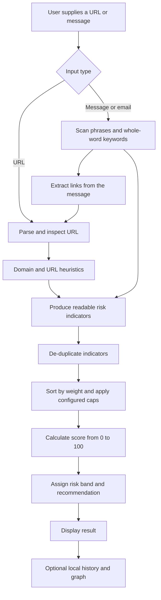

# PhishGuard 🛡️

**An explainable, local-first phishing and scam-message risk analyzer — built to demonstrate Data Structures and Algorithms (DSA) in a practical cybersecurity project.**

> **Educational prototype, not a production security product.** PhishGuard examines the text you provide and reports heuristic warning signs. It does not open URLs, contact websites, perform DNS lookups, call reputation services, or use a trained machine-learning model. A score is not a probability: a low score does not prove safety, and a high score does not prove malicious intent.

---

## Contents

- [1. What is PhishGuard?](#1-what-is-phishguard)
- [2. The problem it addresses](#2-the-problem-it-addresses)
- [3. Project goals](#3-project-goals)
- [4. How PhishGuard works](#4-how-phishguard-works)
- [5. How DSA is used](#5-how-dsa-is-used)
- [6. Risk scoring explained](#6-risk-scoring-explained)
- [7. Features](#7-features)
- [8. Requirements and installation](#8-requirements-and-installation)
- [9. Run PhishGuard](#9-run-phishguard)
- [10. Example scan](#10-example-scan)
- [11. Project structure](#11-project-structure)
- [12. Local data and configuration](#12-local-data-and-configuration)
- [13. Testing, demos, and benchmarks](#13-testing-demos-and-benchmarks)
- [14. Privacy and safe use](#14-privacy-and-safe-use)
- [15. Limitations](#15-limitations)
- [16. Future improvements](#16-future-improvements)
- [17. Learning outcomes and viva questions](#17-learning-outcomes-and-viva-questions)
- [18. Contributing](#18-contributing)
- [19. License](#19-license)

---

## 1. What is PhishGuard?

PhishGuard is a command-line educational application that analyzes suspicious URLs and scam-like messages. It looks for clues such as:

- A domain name that resembles a trusted brand, for example `paypa1.com` resembling `paypal.com`.
- Suspicious words or phrases that may create urgency or ask for credentials, payment, or verification.
- URL patterns such as unusual host structure, suspicious top-level domains, URL shorteners, IP-address hosts, or redirect-like parameters.
- Domains present in a local threat list, or domains that match a locally maintained trusted-domain list.

Instead of only printing “safe” or “unsafe,” PhishGuard gives a **0–100 heuristic risk score**, a risk band (LOW, MEDIUM, HIGH, or CRITICAL), readable reasons for the score, and a recommendation.

PhishGuard is written in Python in this edition. The project is a Python reimplementation of a C++17 educational project; it preserves the core design and intended features, but it is not claimed to behave identically in every platform-dependent detail or benchmark measurement.

## 2. The problem it addresses

People receive suspicious links and messages through SMS, email, messaging applications, and social platforms. A message may create panic, promise a prize, imitate a familiar company, or ask someone to enter a password or payment information. A non-technical user may not know which parts deserve a closer look.

PhishGuard aims to make common warning signs easier to see and explain. It is also a practical way for a student to connect DSA topics—normally taught as separate exercises—to a cybersecurity-oriented application.

**Intended use:** classroom demonstration, DSA practice, algorithm exploration, and awareness of common phishing/scam signals. Do not rely on it as the only check before opening a link or sharing information.

## 3. Project goals

1. Analyze URL strings and message text locally, without opening links or contacting remote hosts.
2. Demonstrate custom implementations of data structures and algorithms in a coherent application.
3. Explain which indicators contributed to a result, rather than hiding the reasoning behind a single label.
4. Keep rules, weights, trusted-domain entries, and sample threat entries editable in local text files.
5. Provide an interactive menu, one-shot scans, batch scanning, scan history, relationship-graph exploration, demos, and benchmarks.
6. Demonstrate basic privacy-conscious handling by redacting selected sensitive patterns before saving scan history.

## 4. How PhishGuard works

### High-level flow



### Step-by-step explanation

1. **Input:** The user provides a URL, message, email text, or a file of inputs through the batch-scan menu.
2. **Parse:** For a URL, PhishGuard separates elements such as the scheme, host, path, query, and fragment, and validates its basic structure.
3. **Analyze:** Domain and URL checks look for suspicious patterns. Message analysis checks watched phrases and whole-word keywords; links found in a message are also analyzed (up to five links per message).
4. **Create indicators:** A detector does not directly change the final score. It produces an indicator with an ID, category, weight, and plain-language description.
5. **Combine evidence:** The risk engine removes duplicate indicators, ranks them, applies the configured keyword contribution cap, adds the retained weights, and clamps the final score to the 0–100 range.
6. **Explain the result:** The application displays the score, risk band, reasons, and recommendation.
7. **Keep local records (optional):** Results can be stored in a local history file. The application also supports viewing relationships among scans, links, domains, and keywords through a graph.

### Architecture at a glance

| Layer | Responsibility | Main module |
|---|---|---|
| Entry point | Command-line options and app launch | `main.py` |
| User interface | Interactive terminal menu and reports | `phishguard/ui.py` |
| URL parsing | URL decomposition, validation, and link extraction | `phishguard/url_parser.py` |
| Detectors | Domain, URL, phrase, and message heuristics | `phishguard/analyzers.py` |
| DSA implementations | Custom hash table, set, heap, trie, and graph | `phishguard/ds.py` |
| Algorithms | String matching, edit distance, sorting, searching | `phishguard/algorithms.py` |
| Risk engine | Indicator de-duplication, ranking, scoring, level selection | `phishguard/engine.py` |
| Local records | Threat/trusted data, configuration, history | `phishguard/detection_data.py`, `phishguard/storage.py` |
| Relationship graph | Adds scan entities and their associations to a graph | `phishguard/graph_builder.py` |
| Demonstration and performance | Repeatable scenarios and lightweight comparisons | `phishguard/demos.py`, `phishguard/benchmark.py` |

## 5. How DSA is used

DSA is not included just as theory or unused sample code. The project uses custom implementations of core structures and algorithms in parts of the analysis workflow, history management, graph exploration, and demonstrations. This makes the project suitable for explaining both **what the algorithms are** and **why a task benefits from them**.

### Data structures

| Data structure | What it means in simple words | How PhishGuard uses it | Typical complexity |
|---|---|---|---|
| **Separate-chaining hash table** | Stores key–value pairs and uses a hash to find a bucket quickly; collisions are stored in a chain. | Lookups for configuration, trusted domains, threat entries, and graph labels. | Average lookup/insert/remove **O(1)**; worst case **O(n)**. |
| **Custom set** | Stores unique values, so duplicates are not kept. | Membership checks and de-duplication of watched values and indicator IDs. | Average membership/insert **O(1)** for the implementation's hash-based set. |
| **Trie (prefix tree)** | Stores words character by character, sharing common prefixes. | Whole-word keyword detection and prefix search in the interactive menu. | Insert/find/prefix search **O(L)** for a key of length L; scanning text depends on text length and maximum keyword length. |
| **Binary max-heap** | Keeps the highest-priority item at the top. | Retrieving top-risk history records and ranking results without repeatedly sorting the full collection. | Top item **O(1)**; push/pop **O(log n)**; heapify **O(n)**. |
| **Adjacency-list graph** | Represents objects as vertices and relationships as edges. | Connects scan records with URLs, domains, and keywords; supports breadth-first and depth-first exploration. | BFS/DFS **O(V + E)**, where V is vertices and E is edges. |

### Algorithms

| Algorithm | Simple explanation | Where it fits | Time complexity |
|---|---|---|---|
| **Levenshtein distance (dynamic programming)** | Counts the minimum insertions, deletions, and substitutions needed to turn one string into another. | Estimates how close a candidate domain is to a trusted domain, which can flag possible look-alikes. | **O(mn)** time; standard table uses **O(mn)** space. |
| **KMP string matching** | Searches for a pattern while reusing information about the prefix already matched. | Matching suspicious phrases and brand-related text. | **O(N + M)** time. |
| **Rabin–Karp** | Uses a rolling hash to locate candidate substring matches, then verifies matches to handle collisions. | Finding a trusted brand/domain string embedded in a different hostname. | Average near **O(N + M)**; worst case **O(NM)** with many collisions. |
| **Stable merge sort** | Divides a list, sorts the parts, and merges them in order while preserving the order of equal items. | Ranking risk indicators and ordering history results. | **O(n log n)** time and **O(n)** extra space. |
| **Quicksort** | Partitions items around a pivot and sorts the partitions. | Algorithm demonstration and benchmark exercises. | Average **O(n log n)**; worst case **O(n²)**. |
| **Binary search** | Finds an item in sorted data by repeatedly halving the search interval. | Search demonstrations and benchmarks over sorted data. | **O(log n)** comparisons. |
| **BFS and DFS** | BFS explores neighbours by distance; DFS follows one path before backtracking. | Exploring connected scans and shared URL/domain/keyword relationships. | **O(V + E)** for adjacency-list graphs. |

Here, `n` is the number of items, `N` is text length, `M` is pattern length, `m` and `n` in edit distance are string lengths, `L` is key length, and `V`/`E` are graph vertices/edges.

### Why use custom DSA implementations?

A production Python application might use built-in `dict`, `set`, sorting utilities, or a graph library for some of these tasks. PhishGuard implements these structures and algorithms explicitly so a student can trace operations, discuss collisions and complexity, test edge cases, and demonstrate how DSA supports a larger program. The project is intended for learning, so the custom implementations are an educational choice—not a claim that they outperform Python's mature built-ins.

## 6. Risk scoring explained

PhishGuard uses a **rule-based heuristic**, not a statistical probability model.

- Detectors produce risk indicators with a stable ID, human-readable description, category, and point weight.
- Indicators with duplicate IDs are counted once.
- Indicators are ranked by weight using the stable merge-sort implementation.
- A configurable cap limits the contribution of keyword indicators so that many similar words cannot dominate the result without limit.
- Retained weights are added; the result is clamped to **0–100**.
- `data/risk_config.txt` defines the thresholds for LOW, MEDIUM, HIGH, and CRITICAL.

Default bands in the supplied configuration are:

| Score | Band |
|---:|---|
| 0–20 | LOW |
| 21–40 | MEDIUM |
| 41–70 | HIGH |
| 71–100 | CRITICAL |

A band describes the rules that matched—not the measured probability that the input is malicious. Scores depend on the currently loaded rules, list contents, weights, and thresholds.

## 7. Features

- Scan a single URL or link.
- Analyze SMS-style messages, social messages, and email text.
- Extract links from message text and analyze them with URL checks.
- Explain the indicators contributing to the result.
- Detect potential trusted-brand look-alikes using string similarity and pattern checks.
- Maintain editable local trusted-domain and synthetic threat lists.
- View, sort, filter, inspect, remove, and clear scan history.
- Save local history with selected sensitive values redacted.
- Batch scan a text file (one message or link per line) from the menu.
- Explore relationships between scans using graph traversal.
- Search watched keywords by prefix using a trie.
- Run 14 deterministic demonstration scenarios.
- Run small DSA and data-structure benchmarks.
- Use the application offline; no third-party Python package is required.

## 8. Requirements and installation

### Requirements

- Python **3.10 or newer**.
- A terminal or command prompt.
- No third-party Python dependencies are required.

Check your Python version:

```bash
python --version
```

If your system uses `python3` for Python 3, replace `python` with `python3` in the commands below.

### Get the project

Download or clone the repository, then enter the project directory. The `data/` folder must remain available so the program can load the supplied configuration and local lists.

```bash
cd PhishGuard-Python
```

No `pip install` step is required for running the source directly.

## 9. Run PhishGuard

### Start the interactive application

```bash
python main.py
```

On Windows, you can also run `run_phishguard.bat` from the project directory.

### Scan one URL

```bash
python main.py --url "https://paypa1.com/signin"
```

### Scan one message

```bash
python main.py --message "Your account is suspended. Verify your PIN now."
```

### Run the demonstration scenarios

```bash
python main.py --demo
```

### Run DSA benchmarks

```bash
python main.py --bench
```

### Run with a custom data directory

```bash
python main.py --data ./data
```

### Choose a different history file

```bash
python main.py --history ./my_scan_history.txt
```

### Run automated tests

```bash
python -m unittest discover -s tests -v
```

### Interactive menu

The terminal menu includes these workflows:

1. Scan a URL/link.
2. Scan a message.
3. Scan multi-line email text; enter `END` on its own line to finish.
4. View, sort, filter, inspect, remove, or clear scan history.
5. View, add, update, remove, or search local synthetic threat entries.
6. View, add, or remove trusted domains.
7. View statistics and highest-risk history entries.
8. Exit.
9. Batch scan a text file, one input per line.
10. Explore links between scans using BFS/DFS graph traversal.
11. Search suspicious keywords by prefix.
12. Run 14 demonstration scenarios.
13. Run DSA benchmarks.

## 10. Example scan

Command:

```bash
python main.py --url "https://paypa1.com/signin"
```

Example output from the supplied configuration:

```text
Risk Score : 42 / 100
Risk Level : HIGH

Why this score:
 [+30] This website name is very similar to a trusted website (paypal.com), which may indicate impersonation.
 [+7] The link contains the word "signin", which scammers often use to look trustworthy or create pressure.
 [+5] The main website name mixes numbers into a word, a trick used to imitate real names.

Recommendation:
Several suspicious signs were found. Do not click the link or share personal information. Contact the company using the phone number on its official website.
```

The exact result depends on the configuration and local lists. The sample is an illustration of how the explanation is presented, not proof that the URL is live, malicious, or safe. The application does not contact the domain.

## 11. Project structure

```text
PhishGuard-Python/
├── main.py                       # CLI entry point
├── run_phishguard.bat            # Windows launcher
├── phishguard/
│   ├── __init__.py
│   ├── __main__.py               # Package entry point
│   ├── types.py                  # Enums, indicators, and result models
│   ├── ds.py                     # Custom hash table, set, heap, trie, graph
│   ├── algorithms.py             # String matching, edit distance, sorts, search
│   ├── text_utils.py             # Text helpers and privacy redaction
│   ├── detection_data.py         # Config and local-list loading
│   ├── url_parser.py             # URL parsing and link extraction
│   ├── analyzers.py              # Domain, URL, and message checks
│   ├── engine.py                 # Indicator aggregation and risk scoring
│   ├── storage.py                # Scan history, filtering, and statistics
│   ├── graph_builder.py          # Build scan relationship graph
│   ├── ui.py                     # Interactive terminal interface
│   ├── demos.py                  # Repeatable demo scenarios
│   └── benchmark.py              # Lightweight DSA benchmarks
├── data/
│   ├── risk_config.txt           # Weights, caps, thresholds, and limits
│   ├── trusted_domains.txt       # Local trusted-domain reference data
│   ├── sample_threats.txt        # Synthetic sample threat entries
│   ├── suspicious_keywords.txt   # Watched words and their weights
│   ├── suspicious_phrases.txt    # Watched phrase patterns
│   ├── suspicious_tlds.txt       # Watched domain endings
│   ├── url_shorteners.txt        # Known URL-shortener names
│   ├── known_tlds.txt            # Known top-level domains
│   └── public_suffixes.txt       # Small local suffix list
├── tests/
│   └── test_phishguard.py        # unittest suite
├── docs/
│   ├── ARCHITECTURE.md            # Module flow and design choices
│   ├── COMPLEXITY.md              # Complexity reference
│   ├── DEMOS.md                   # Demo descriptions and expected bands
│   ├── PRESENTATION.md            # Presentation outline
│   ├── REPORT.md                  # Project report
│   ├── ROADMAP.md                 # Recommended improvements
│   └── VIVA.md                    # Oral-exam preparation
├── .github/workflows/             # GitHub Actions CI and release workflows
├── pyproject.toml
├── requirements.txt
├── LICENSE
└── README.md
```

## 12. Local data and configuration

PhishGuard reads its rules and reference entries from local text files. These files make it possible to explore how changing a rule changes a result without rewriting the detector code.

| File | What it controls |
|---|---|
| `data/risk_config.txt` | Indicator weights, scoring caps, limits, and score-band thresholds. |
| `data/trusted_domains.txt` | Trusted domains and their associated brand/category fields. |
| `data/sample_threats.txt` | Sample threat records in the form `domain|category|risk|note`. The supplied domains are synthetic. |
| `data/suspicious_keywords.txt` | Watched words, categories, and weights in the form `word|category|weight`. |
| `data/suspicious_phrases.txt` | Suspicious phrase patterns and categories. |
| `data/suspicious_tlds.txt` | Watched top-level domain endings. |
| `data/url_shorteners.txt` | URL-shortener host names. |
| `data/known_tlds.txt` | A local list of known top-level domains. |
| `data/public_suffixes.txt` | A small local suffix list used in host interpretation. |

Review entries before using customized lists. An incorrect threat-list entry can cause a legitimate domain to be flagged. These lists are not automatically updated from the internet.

## 13. Testing, demos, and benchmarks

### Automated tests

Run:

```bash
python -m unittest discover -s tests -v
```

The test suite covers algorithms, data-structure edge cases, URL parsing, message analysis, scoring, configuration loading, history persistence and redaction, graph traversal, and demo score ranges.

**Verification note for this project snapshot:** the included test suite was run during preparation of this README and completed with **19 tests passing**. Re-run it on your own computer to verify your Python environment and project copy.

### Demonstration scenarios

Run:

```bash
python main.py --demo
```

There are 14 deterministic examples, including trusted-looking URLs, suspicious domain patterns, possible look-alike domains, embedded brand names, IP-address links, synthetic scam messages, a likely false-positive scenario, malformed URL input, and a likely false-negative scenario. The demo runner checks whether each result falls within its expected risk band.

The demonstration set is **not** a real-world accuracy evaluation. Its sample links use the reserved `.test` TLD or documentation-only IP ranges.

### Benchmarks

Run:

```bash
python main.py --bench
```

The benchmark module offers lightweight comparisons for algorithm and data-structure exercises. Treat timings as machine- and runtime-dependent educational measurements, not a comprehensive performance study. Python timings cannot be compared directly with C++ timings without a carefully controlled setup.

## 14. Privacy and safe use

- **Local-only analysis:** PhishGuard does not open, fetch, or ping a supplied link. It does not query DNS or external reputation APIs.
- **History file:** results may be written to a local text file. Before writing, the application redacts selected information, including URL query strings, URL user-info, secret-like values after certain terms, and long digit sequences.
- **Redaction is not a guarantee:** it cannot catch every possible personal or secret value. Avoid entering real passwords, one-time codes, payment information, private messages, or confidential URLs when testing.
- **Trusted lists can be wrong or outdated:** a trusted-list match is not a proof that a URL is safe.
- **Verify out-of-band:** navigate to an organization's official app/site yourself or use a verified contact method rather than trusting a link in a suspicious message.

## 15. Limitations

PhishGuard is an educational, rule-based prototype. It has important limitations:

1. **Heuristics, not certainty:** rules can flag legitimate messages (false positives) and miss well-crafted scams (false negatives).
2. **No live reputation checks:** it does not contact a site, inspect its certificate, resolve its IP, or query a threat-intelligence feed.
3. **Small local lists:** its examples and local lists are not a complete or authoritative inventory of domains and suffixes.
4. **Language coverage:** the supplied phrase and keyword rules are small and primarily English-focused.
5. **Look-alike handling is incomplete:** similarity and punycode checks are clues, not a complete Unicode confusable detector.
6. **Untrained weights:** point weights and score thresholds are editable judgement-based settings, not learned or calibrated probabilities.
7. **Not validated for deployment:** it has not been established as an enterprise security control or as a substitute for browser protection, mail filtering, or professional incident response.

**Interpretation rule:** LOW means “few warning signs were found by these checks,” not “confirmed safe.” HIGH or CRITICAL means “several/significant warning signs matched,” not “confirmed malicious.”

## 16. Future improvements

Potential next steps include:

- Evaluate the detector using a reviewed, labelled dataset and report precision, recall, false-positive rate, and false-negative rate.
- Maintain reviewed data sources with timestamps, provenance, and a safe update mechanism.
- Replace the small public-suffix list with a maintained, versioned source.
- Improve Unicode and internationalized-domain confusable analysis.
- Add carefully reviewed local-language phrase sets.
- Validate configuration schemas and make file updates safer.
- Improve the user interface and accessibility after detection quality has been evaluated.
- Add clearer export/report formats and reproducible performance experiments.

These are proposals, not features currently claimed by this version.

## 17. Learning outcomes and viva questions

### What does PhishGuard do?
It analyzes URL and message text locally for common phishing/scam warning signs, assigns a heuristic risk score, and shows the indicators behind the result.

### Why use a hash table?
The application frequently checks whether a domain, configuration key, or threat entry exists. A hash table provides average constant-time lookup under typical conditions.

### Why use a trie?
A trie is useful for word/prefix operations. PhishGuard uses it to find watched keywords and offer prefix-based keyword search.

### Why use Levenshtein distance?
It estimates the character edits needed to turn one string into another. A small distance between a domain and a trusted brand can suggest a look-alike, but it does not prove wrongdoing.

### Why use KMP and Rabin–Karp?
Both are string-search algorithms. KMP searches patterns in linear time; Rabin–Karp uses rolling hashes to find candidate substrings, verifying candidates to account for collisions.

### Why use a heap?
A max-heap makes it efficient to access the highest-priority item, such as a high-risk scan record.

### Why use a graph?
A graph represents relationships among scans, URLs, domains, and keywords and enables BFS/DFS exploration.

### How is the risk score calculated?
Detectors emit weighted indicators. The engine de-duplicates them, ranks them, caps keyword contributions according to configuration, sums the retained weights, clamps the result to 0–100, and assigns a configured risk band.

### Is the score the probability that a URL is malicious?
No. It is a configurable heuristic score and has not been calibrated as a probability.

### Does PhishGuard open the link?
No. It parses and analyzes the supplied text locally; it does not make network requests.

### Can PhishGuard make mistakes?
Yes. A genuine urgent message may match suspicious rules, while a carefully written scam may avoid the project's watched patterns. The demos intentionally include examples of both risks.

For additional oral-exam preparation, see [`docs/VIVA.md`](docs/VIVA.md). For implementation details, see [`docs/ARCHITECTURE.md`](docs/ARCHITECTURE.md) and [`docs/COMPLEXITY.md`](docs/COMPLEXITY.md).

## 18. Contributing

For a classroom project, useful contributions include clearer explanations, additional unit tests, carefully documented heuristics, better edge-case handling, accessibility improvements, and reviewed sample data. Keep any new test cases safe and synthetic; do not add real users' personal information or private messages. If adding a detection rule, document its rationale and consider which legitimate inputs it might flag.

## 19. License

This project is distributed under the MIT License. See [`LICENSE`](LICENSE) for the full license text.

---

### Final reminder

PhishGuard's main educational value is the connection between cybersecurity heuristics and DSA: parsing and analysis produce indicators; custom data structures and algorithms help organize, search, compare, rank, and relate that information; and the risk engine turns the evidence into an explanation a user can review. It is a learning prototype, not a guarantee of safety.
